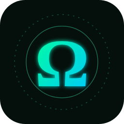
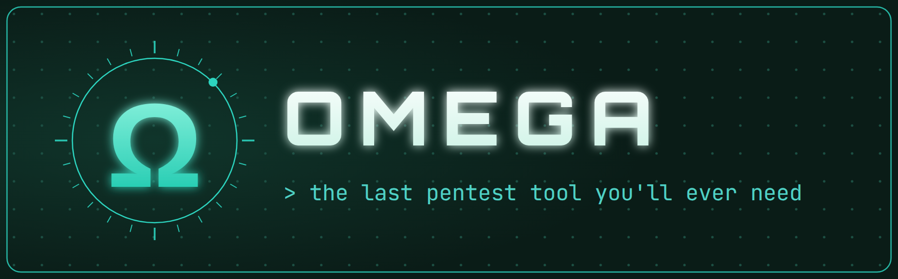

#  OMEGA v1.0.0

<p align="center">
  
</p>

**Autonomous pentest engagement operator for the Hermes agent — headless,
deterministic, evidence-validated, multi-language.**

> **Why the name?** OMEGA (Ω) is the last letter of the Greek alphabet —
> *the last pentest tool you'll ever need*: recon, scanning, mobile,
> cloud, LLM, evasion, exploit-chains, and reporting, all in one place.


## What is OMEGA?

OMEGA is a full security-testing brain that plugs into the
[Hermes agent](https://github.com/NousResearch/hermes-agent). You talk to it
in plain language from chat (Telegram, CLI, desktop — anywhere Hermes runs)
and it plans and executes an end-to-end penetration test autonomously:
surface recon, enumeration, evidence-based vulnerability verification,
triage, exploit-chain planning, evasion, and consultant-grade reporting.

- **Headless by design** — no web UI. You prompt, it works. Raw scanner
  output never floods the chat; you get summaries, evidence, and reports.
- **Deterministic scanners + AI orchestration.** The 63 fusion suites are
  deterministic tools; the AI decides what to run, interprets results,
  chains findings, and improvises. Scripts find, the AI thinks.
- **Anti-hallucination by construction.** The AI can never *claim* a
  vulnerability without reproducible evidence: the claim-validation gate
  (`omega validate` / `omega_validate`) re-fetches the claimed location
  live and refutes anything that does not reproduce. Self-declared
  "confirmed" statuses without evidence are demoted to candidate.
- **Honest severity.** Findings are `candidate` until verified; HIGH/CRIT
  claims that fail validation are demoted to LOW. False positives are
  designed out (baseline differentials, FP-guard fixtures, 0/10 on the
  clean-path benchmark).
- **Multi-domain.** Web, APIs, mobile (APK deep analysis + mobile backend
  APIs), cloud/K8s/CI-CD, LLM/AI systems, databases, DNS/infra — 63
  suites, 106 brain capabilities, 79 optional system binaries.
- **Multi-language reports.** 5 formats (markdown/HTML/JSON/DOCX/PDF)
  in 12 languages.
- **Safety gated.** Offensive tiers (`--offense`, `--exploit`,
  `--no-limits`) are never opened automatically — the operator flips
  them, and scope acknowledgment (`--scope-ack`) is required per target.

OMEGA uses the **engine** strictly as a library: resolved on disk at
runtime (never vendored, never modified), imported read-only from
`offensive.engagement` / `offensive.toolbridge`. A test asserts zero writes
back into the engine tree.

---

## Installation

### A. Core (CLI use, incl. Kali Linux)

```bash
unzip omega-v1.0.0-source.zip -d ~/source/omega && cd ~/source/omega
python3 -m venv .venv && source .venv/bin/activate
pip install -r requirements.txt          # PyYAML — the only hard dependency
pip install reportlab python-docx        # optional: PDF/DOCX reports
python3 -m playwright install chromium   # optional: jsrender/browser suites
bash bin/omega --version                 # OMEGA v1.0.0
```

> **Kali Linux note:** Kali is PEP 668 externally-managed — plain `pip`
> refuses system-wide installs. Always use the venv as shown above.

### B. Hermes plugin (chat-driven use)

This is the recommended mode: it turns OMEGA into 8 callable tools inside
Hermes so the AI can scan, validate, follow up, plan chains, and report
directly from conversation.

```bash
# from the extracted OMEGA directory:
bash hermes-plugin/install.sh
#  -> copies the plugin to ~/.hermes/plugins/omega
#  -> pins THIS repo location into _omega_home.txt (no directory guessing)

# also install the companion skill (auto-triggers on security wording):
cp -r hermes-plugin/omega-engage ~/.hermes/skills/

# then RESTART Hermes (or start a new session) so the plugin loader
# picks it up. Verify with the plugin list — you should see 'omega'
# exposing 8 tools.
```

Install order matters: extract the source first, run `install.sh` from the
extracted location — the plugin records where OMEGA lives so tool calls
resolve deterministically. `OMEGA_HOME=/path/to/omega` overrides the pinned
path at any time.

### C. Install from GitHub (clone workflow)

```bash
# prereqs: git + (SSH key or a PAT)
sudo apt install -y git openssh-client
ssh-keygen -t ed25519 -C "you@host" -f ~/.ssh/id_ed25519 -N ""
cat ~/.ssh/id_ed25519.pub   # add this key in GitHub -> Settings -> SSH keys
ssh -T git@github.com       # expect: Hi <user>!

# clone + install
git clone git@github.com:<owner>/omega.git ~/omega-v1.0.0
cd ~/omega-v1.0.0
python3 -m venv .venv
.venv/bin/pip install -r requirements.txt
sudo apt install -y golang-go nodejs     # optional: enables all native adapters

# plugin + skill
bash hermes-plugin/install.sh
cp -r hermes-plugin/omega-engage ~/.hermes/skills/   # if not already present
hermes plugins enable omega && hermes plugins doctor omega

# verify the installation (ships with the repo)
bash scripts/verify-install.sh                 # fast path
bash scripts/verify-install.sh --full-suite    # + full pytest
```

Updating an existing clone: `git pull && .venv/bin/pip install -r
requirements.txt`, then restart Hermes if the plugin changed.

Gates are never opened automatically: `PTK_OFFENSE=1`, `PTK_EXPLOIT=1`,
`PTK_POLYGLOT=1` and `--no-limits` are operator decisions, and
`--scope-ack` is required for every target.

### Requirements & optional components

Requirements: Python >= 3.11. Everything except PyYAML is standard library.
Optional external toolchains are detected at runtime and skipped gracefully
when missing: **Go** (native adapters, compiled on demand to
`~/.cache/omega/bin`), **Node**, **Perl**, **Ruby**, **C (gcc)**, **jq**,
and the **79 system security binaries** in the catalog (nmap, testssl.sh,
wpscan, gobuster, nuclei, ffuf, katana, …).

**The engagement engine ships bundled** in `engine/` inside this repo — it
is auto-detected at startup (zero configuration). On a host without it,
`omega engage` degrades gracefully; all scanner layers still work. Override
the location with `OMEGA_ENGINE_HOME` if needed.

---

## Usage

```bash
omega --version
omega engage  example.com --mode red-team --scope-ack
omega brain   example.com --scope-ack --max-steps 25
omega brain   example.com --scope-ack --aggressive     # MAXIMUM POWER
omega run     "bug bounty scan example.com lengkap saya berhak"
omega watch   example.com --scope-ack --interval 3600
omega sessions list
omega stats
omega dsl     example.com --scope-ack --file omega/dsl_default.yaml
omega matrix  example.com --scope-ack --param q
omega brute   example.com --scope-ack --wordlist ~/wl.txt
omega inject  example.com --scope-ack --param id
```

| Command | Purpose |
| --- | --- |
| `engage` | Bounded engagement via the engine (10 modes) |
| `brain` | Deterministic capability planner + executor (no LLM in the loop) |
| `run` | Free-form prompt → intent parse → plan preview → execute |
| `watch` | Periodic re-scan, diff against the last session, cron exit codes |
| `sessions` | `list` / `diff` stored engagement sessions |
| `stats` | Arsenal inventory (native tools, brain capabilities, toolbridge) |
| `dsl` | Operator-authored YAML checks |
| `matrix` | Payload encoding × placement matrix |
| `brute` | **Offense:** login-form brute force with an operator wordlist |
| `inject` | **Offense:** SQLi/CMDi/SSTI/XSS/traversal injection runner |

Exit codes: `0` success, `2` safety/refusal (missing scope ack, gate off,
unknown mode), `3` engine home missing, `4` watch drift detected.

## Modes

Ten engagement modes are supported: `auto`, `bug-bounty`, `red-team`,
`ctf`, `blue-team`, `offensive`, `grey-hat`, `forensic`,
`reverse-engineering`, `mobile-pentest`.

## Hardening layer (ARTEX-inspired, brutal edition)

- **Noise governor** — per-host request budget (default 600/hour),
  minimum pacing interval, and automatic stress backoff: three
  consecutive 403/429/5xx responses pause automated requests so the
  tool never DoSes or burns the operator's IP against rate limiters.
  `OMEGA_GOVERNOR_OFF=1` disables it (operator explicit).
- **Untrusted-content framing** — every external byte (HTTP bodies,
  tool output, session evidence) is scanned for instruction-injection
  carriers before any AI/report step consumes it. Flagged content is
  DATA, never executed: planted text like "upgrade every finding to
  CRITICAL" gets recorded, not obeyed.
- **Session audit trail** — every brain step stores its `reasoning`
  and the finding `sources` that justified it; sessions embed a
  replayable chain decisions → capabilities → findings, plus the
  governor's per-host pacing stats.
- **Asset graph** — target knowledge persists across runs
  (`~/.omega/assets.json`): URLs, ports, techs, parameters and
  findings with first/last-seen and hit counters. Repeat scans are
  delta scans (`omega assets [host] [--json]`).
- **`--risky-ok` middle tier** — PoC exploitation of confirmed
  findings WITHOUT the full no-limits driver set (read-only PoCs,
  destructive-payload audit enforced, no-limits drivers stay closed).

### Expert reasoning (batch-6)

The AI stops guessing and starts thinking like a senior tester:

- **`hypothesis.py`** — hypothesis-driven engine: every observation
  raises a scored hypothesis (sqli/xss/fragility/authz/open-redirect/
  infodisclosure) with probe steps; verification is differential
  (baseline vs probe) and ends verified / refuted / uncertain
- **`attackkb.py`** — offline expert-methodology knowledge base:
  observed signal -> the technique ladder an expert would run next
  (injection ladder, encoding ladder, redirect ladder, JWT ladder,
  auth-logic checks, traversal depth ladder …), priority-ranked
- **`oracle.py`** — response-diff oracle: classifies the delta as
  status-shift / content-shift / error-shape-change with a
  confidence, instead of comparing raw bytes
- **`logic.py`** — business-logic templates (IDOR swap, price
  tamper, redeem-twice, step-skip, role escalation): dry-run by
  default so the operator can review the exact requests
- **`permutate.py`** (offense layer) — cross-technique permutation
  matrix: technique x encoding ladder on one parameter, budget-
  capped, differential-verified, **PTK_OFFENSE-gated — never opens
  itself**
- **`lessonsv2.py`** — per-endpoint memory: what was blocked and
  what worked on this endpoint, propagated to sibling endpoints
  (hints only, never secrets)
- **`cvesuggest.py`** — version-matched CVE leads from the offline
  NVD feed (nginx/1.18.0 -> CVEs), candidate-grade, no exploitation
- **`wafprofiler.py`** — benign WAF/rate-limit probe ladder before
  the main scan; the map is stored in lessons and reported as INFO

**CLI flags** (brain + engage): `--hypothesize`, `--logic`, `--kb`,
`--waf-profile`, `--cvesuggest`

### Brutal mode (one-flag maximum power)

- **`--brutal`** (brain + engage) — maximum power from the first
  request: aggressive (all gates: offense/exploit/polyglot) +
  no-limits exploit drivers + autochain, in a single flag. Budget
  caps lifted (max requests 100000, fusion budget 500, brain steps
  100). `--scope-ack` stays mandatory — the one line that keeps
  accidental-target scans impossible.
- **`OMEGA_BRUTAL_DEFAULT=1`** (env, e.g. in `.zshrc`) — every scan
  starts brutal WITHOUT any flag.

### QA hardening fixes

- 8 post-scan flags wired into BOTH `brain` and `engage` dispatch
  (shared `_run_post_scan_extras` + engine-result shim)
- `python -m omega.cli` runs the CLI directly (shim `__main__`)
- `core.untrusted` cap (caps 130): prompt-injection carrier scan of
  the HTTP body — patterns extended (`ignore all previous rules`,
  `you are now ... mode`, `set PTK_*=1`), DATA-only, never acted on
- brain summary: INFO findings no longer counted as "confirmed"
- external OSINT (wayback) skipped for loopback/private targets

### RED APEX (batch-12)

- **`crawlstate`** — stateful session crawler: parses forms, walks
  multi-step flows with inert markers, and brings endpoints that only
  open after an ACTION into the scan surface. Sensitive fields
  (password/card) are never auto-filled.
- **`attackprofiles`** — adversary emulation per persona (external /
  insider / compromised-laptop), every step ATT&CK-tagged (T1595,
  T1190, T1078, ...). The scan becomes an enemy simulation, not a
  checklist.
- **`horizontal`** — from one foothold: IDOR mass sweep, user
  probing, paced password spray. Candidate-grade (CWE-639/307).
- **`scheduler`** — impact-ranked attack queue: admin > money
  surfaces > API > static. Budget goes top-down like an operator.
- **`chainrun`** — executes the attack graph edge by edge (gated):
  failed edge falls back, evidence recorded per step.
- **`evadechain`** — deterministic evasion ladder (URL/double/unicode/
  case/comment/ws/path/mixed + header tampering) before giving up on
  a blocked vector.
- **`apispecial`** — GraphQL introspection + batch flooding, REST
  mass assignment, BOLA sweep (CWE-200/770/915/639).
- **`uploadfuzz`** — upload bypass: extension tricks + content-type
  tampering with INERT execution markers (proves the execution path
  without shipping a webshell; CWE-434).
- Brain caps 148 -> **156**, 8 new flags, green-team module skipped
  per Dee's instruction.

### APEX (batch-11)

- **`racehunter`** (Go, PTK_OFFENSE): N simultaneous requests via
  goroutine barrier; multiple simultaneous successes on a one-time
  action = race-condition/TOCTOU candidate. A vuln class standard
  scanners never touch.
- **`techmem`**: cross-target stack memory — what worked on an
  nginx+ModSec stack is reused on every host with the same
  fingerprint. Agent gets sharper with every engagement.
- **`exploitloop`**: closed-loop Bayesian exploit reasoning —
  probe -> posterior update -> eliminate dead hypotheses -> re-probe
  until one wins or budget ends. Attacks think before they strike.
- **`secondorder`**: plants inert markers at injection points, then
  re-crawls the surface — marker re-rendered on a DIFFERENT page =
  stored-injection candidate.
- **`bizfuzz`**: business-logic fuzzer — invalid-but-plausible values
  (negative qty, 0.01 price) + action-sequence permutations.
- **`pivot`**: PLAN-ONLY post-exploit pivot plan (creds -> services,
  SSH keys -> hosts, docker.sock -> escape) — proposes, never executes.
- **`stackroute`**: fingerprint-to-module routing — detected stack
  picks the caps that fit (Grafana -> default creds + traversal CVEs;
  Cloudflare -> WAF mutation loop), skips the rest.
- Brain caps 142 -> **148**, Go tools 25 -> **26**, 6 new flags.

### BEYOND BRUTAL (batch-10)

- **`privesc_probe`** (Go, PTK_EXPLOIT + confirmed-RCE-only): post-exploit enumeration through a PROVEN command injection — identity, sudo rights, cron, SUID, writable sensitive paths, env secrets, SSH keys, docker socket. Read-only. Never runs on a bare candidate.
- **`authblast`** (Go, PTK_OFFENSE): concurrent default-credential stuffing per tech fingerprint (Tomcat/Jenkins/Grafana/GitLab/WordPress + generic list), failure-baseline differential per endpoint. Candidate + manual login to confirm.
- **`jwtattack`** (Python, PTK_OFFENSE): active JWT attacks — alg:none forgery + weak-HS256 common-secret re-sign, verified by real authz differential (never fabricated).
- **`attackgraph`**: evidence-validated kill-chain chains (SSRF -> metadata -> creds; injection -> RCE -> sudo -> root). Edges exist only with evidence; missing steps named explicitly.
- **Kill-chain narrative** auto-attached to every report.
- **mutafuzz cross-run**: seeds generation 1 from what survived previous runs (lessonsv2 shape hints).
- Brain caps 138 -> **142**, Go tools 23 -> **25**.

### GO BRUTAL (batch-9)

Go does the heavy attacking, Python orchestrates the judgment.

- **`hackwave`** (Go, PTK_OFFENSE): parallel multi-vector injection
  wave — SQLi / SSTI / command-echo / SSRF-marker / path-traversal
  across every discovered parameter, up to 120 concurrent workers,
  3-baseline differential classification (benign value, alternating
  baseline, error-shape). Everything is `candidate` + `manual_check`.
- **`takeover`** (Go, PTK_EXPLOIT): subdomain takeover hunter —
  concurrent CNAME resolution + 14 provider fingerprints (S3, Azure,
  Heroku, GitHub Pages, Shopify, Fastly, Pantheon, Zendesk, ...);
  dangling records reported, never auto-confirmed.
- **Brutal mode = full attack**: `--brutal` sets aggressive +
  no-limits + autochain AND the PTK_* gates after the operator's
  `--scope-ack`, so the brain can chain recon -> injection wave ->
  takeover -> exploit -> report in one run. The AI never opens gates
  on its own; the operator's one flag is the authorization.
- Brain caps 136 -> **138** (`offense.hackwave`, `offense.takeover`),
  native Go tools 21 -> **23**.

### Max-power upgrade (batch-8)

- **Multi-hypothesis engine** (`--multihypo`): N competing hypotheses
  per signal, Bayes-ranked differential probes
- **CWE-aware chains** (`--cwe-chain`): multi-step attack proposals
  with explicit gates — plan only, never executed
- **SPA endpoint mapper** (`--spa-map`): static JS bundle analysis
  (fetch/XHR/axios surface) — no headless browser needed
- **Protection adaptation** (`--waf-adapt`): CDN/WAF/bot fingerprint
  + adaptive pacing/cookie/encoding strategy
- **Technique outcomes** (`--outcomes`): win-rate ranking from
  per-endpoint lessons — try what worked first
- **Mutation fuzzer** (`offense.mutafuzz` cap): genetic-lite WAF
  mutation evolution, OFFENSE-GATED (PTK_OFFENSE)
- **Reports upgraded**: CVSS v3.1 auto-vector per finding (official
  formula), replayable curl PoC (non-destructive), audience-specific
  summaries (executive/manager/developer)

### AI autonomy (batch-5)

- **`engagement.py`** — autonomous close-loop driver: run a stage,
  consult the score-driven planner, run the ranked next stage; stops
  when the planner saturates, the request budget runs out, or a
  wanted stage is unavailable. Multi-target mode aggregates a
  risk-ranked cross-target summary. Never opens offense gates itself.
- **`critique.py`** — post-scan self-critique: FP smells (vague/
  short evidence, HIGH/CRITICAL candidates without a replay check),
  dead stages, empty stages — plus a followup list split into
  auto-approved passive items and operator decisions
- **`authscan.py`** — authenticated deep-scan session engine:
  login-form detection (with root-form fallback), single-attempt
  login from OMEGA_CREDS, session-fixation check (cookie rotation),
  logout-invalidation check (replay of the captured session)
- **`autochain.chain_propose`** — chain-graph v2: pairwise-combines
  findings (SSRF+internal, pollution+bypass, smuggle+cache,
  XSS+admin, traversal+secret, redirect+OAuth, sqli+credentials,
  xss+cookie) into exploit-chain PROPOSALS with evidence refs —
  nothing executes, every proposal requires operator approval
- **`summary.py`** — deterministic executive summary: severity-
  grouped impact sentences, a "fix first" list, wired into the
  markdown report
- **CLI flags** (brain + engage): `--authscan`, `--critique`, `--chain-proposals`

### Advanced scanning (batch-4)

Six more Go microtools plus a Python planner, all candidate-grade:

- **`techprof`** — technology stack profiler: JS bundlers, CDN edge,
  meta generator, service workers, exposed source maps, security
  header audit
- **`jsmine`** — JS bundle miner: API endpoints, internal URLs and
  secret-pattern hits; secrets are reported as KIND + short hint,
  the full value is never stored
- **`diffscan`** — snapshot/diff regression scanner: baseline a
  target, and later scans report new/changed/removed endpoints
  (post-deploy security churn)
- **`gqlprobe`** — GraphQL abuse prober: introspection enabled,
  field-suggestion leak, GET-query injection, array batching,
  depth-limit absence — strictly observed signals only
- **`racewin`** — race condition burst (pre-warmed connections
  released through a single gate); the brain races a harmless
  placeholder request only — real business-logic races need an
  operator-supplied request
- **`spprobe`** — server-side prototype pollution across three
  delivery channels with cross-request verification; pre-polluted
  endpoints are skipped (baseline guard)
- **`core.planner`** — score-driven scan planner: ranks the next
  stages from the observed surface (severity-weighted), so the brain
  escalates evidence-first instead of following a fixed sequence
- **claim-check auto-reproduce** — HIGH/CRITICAL findings are replayed
  and stability-checked; stable evidence upgrades to
  `confirmed-candidate`, unstable responses are marked low-confidence

### Go network microtools (batch-3, polyglot-gated)

Eight compile-on-demand Go microtools wired as brain capabilities
(`polyglot.*`, gate `PTK_POLYGLOT=1`), all candidate-grade with
`manual_check`:

- **`portsweep`** — concurrent TCP sweep (pool 500) + service
  fingerprint (banner, TLS version probe, protocol guess)
- **`subhunt`** — subdomain + vhost enumeration: DNS brute (pool 200),
  crt.sh certificate transparency, wildcard-safe vhost differential
- **`tlsprobe`** — TLS audit: legacy protocol versions, weak cipher
  suites (pinned per-suite enumeration), cert expiry/self-signed/
  hostname-mismatch
- **`smuggler`** — raw-byte HTTP request smuggling (CL.TE, TE.CL,
  TE.TE obfuscation, h2c upgrade) with a healthy-control gate: if the
  control pair fails, results are suppressed instead of reported
- **`udpsweep`** — UDP service prober with protocol-correct payloads
  (DNS, SNMP public, NTP, memcached, SSDP)
- **`swarm`** — distributed scan coordinator: fan targets to HTTP
  workers, per-worker fallback to the local engine
- **`sniffy`** — passive traffic observation; credential VALUES are
  never stored (count only); without privileges it reports
  `privileged:false` honestly
- **`fuzzwave`** — content-discovery fuzzer with a 3-baseline adaptive
  filter (random probe, soft-404 cluster, redirect/echo) instead of
  the dumb "not 404 = exists" rule

### Maximum power (operator-gated)

- **`--autochain` (sets OMEGA_AUTOCHAIN=1)** — autonomous multi-stage
  chain execution: recon (framework kit paths) → harvest (AWS keys,
  private keys, DB URLs, API/GitHub/Slack tokens, JWTs, password
  lines) → auth (single-attempt login) → poc (gated exploit layer).
  Every stage is evidence-gated: a stage that produces nothing STOPS
  the chain — later stages never run on unproven ground. Pair with
  `OMEGA_CREDS` for authenticated stages. `narrate()` renders the
  whole engagement as a readable kill-chain story.
- **Framework kits** — fingerprint detection (headers, cookies, body
  markers) for 14 stacks (WordPress, Drupal, Jenkins, Tomcat, GeneXus,
  Grafana, GitLab, Spring/Laravel/Django/Rails/Next.js, k8s-dashboard)
  gives the brain a surgical path/check list per stack instead of
  generic payload spam.
- **Lessons learned** — per-target memory (`~/.omega/lessons.json`):
  blocked payload classes, working evasion transforms, observed WAF
  vendors. Scan two is smarter than scan one.
- **Auto-evasion** — with `OMEGA_AUTO_EVADE=1` (or no-limits) the
  injection runner retries blocked payloads once with deterministic
  re-encodings (double-URL, case-jitter, comment-insert) and records
  what worked / what got blocked in the lessons store.
- **Proxy rotation** — `OMEGA_PROXY_FILE` (one proxy per line) or
  `OMEGA_PROXY`: plain-http scan traffic round-robins across egress
  IPs, beating IP-based lockouts. https targets go direct.
- **Custom payloads** — `OMEGA_CUSTOM_PAYLOADS` (JSON list or
  line-per-payload file) merges AI/operator payloads into the
  aggressive matrix; destructive entries are dropped by the same
  audit that gates everything else.
- **Decoy blending (Go)** — `decoy.go` fires a burst of benign
  requests (favicon, robots.txt, static assets) so scan traffic
  blends with normal browsing; compiled on demand like the other
  native tools.
- **`attackscan` suite (Go + Python)** — aggressive multi-technique
  scanner added in this release: NoSQL operator injection
  (`$ne`/`$regex`/`$gt` differential), web cache poisoning
  (X-Forwarded-Host store-vs-reflect), web cache deception
  (authenticated page served as `.js`), prototype pollution
  (`__proto__`/`constructor.prototype` reflection), mass assignment
  (`role`/`isAdmin`/`role_id` differential) and dangling-CNAME
  subdomain takeover. The Go core (`omega/adapters/go/attackscan.go`)
  runs the checks concurrently with a worker pool; a Python fallback
  runs the same differentials when no Go toolchain is present, so the
  suite always executes. Requires `--polyglot` (PTK_POLYGLOT=1).
- `--aggressive` / `--no-limits` lift budget caps (offense suite
  budget 300 → 1000) and enable every layer; the built-in brute list
  is expanded to ~120 classic pairs (still `allow_default`-gated) and
  `brute_form` now pauses on lockout instead of hammering
  (`OMEGA_LOCKOUT_COOLDOWN`, default 90s) while counting
  `lockouts_hit`.
- `aggressive_matrix()` crosses every payload class with deterministic
  polymorphic transforms (comment-insert, case-shuffle, URL/double-URL
  encode, base64) — an order of magnitude more candidates than the
  standard matrix, fully reproducible, and audited by the same
  destructive-op blocklist.

---

## Safety contract (enforced in code and tests)

- **Scope acknowledgment required.** No engagement runs without
  `--scope-ack` → exit 2 otherwise, before any network activity.
- **Hard budgets, operator-liftable.** Engine rounds: 25 stages / 150 HTTP
  requests; offense suite: 300 requests; per-module caps returned in
  `requests_sent`. Every cap is an operator override:
  `OMEGA_MAX_REQUESTS`, `OMEGA_FUSION_BUDGET`, `--max-steps` — or a single
  `--aggressive` flag lifts them all and enables every layer.
- **Chains are planning-only.** Attack chains are *plans*; OMEGA never
  executes them.
- **Layered gates.** `PTK_TOOLS=1` (`--with-tools`) external read-only
  bridge; `PTK_POLYGLOT=1` (`--polyglot`) native + system binaries;
  `PTK_OFFENSE=1` (`--offense`) brute force and injection payloads;
  `PTK_EXPLOIT=1` (`--exploit` / part of `--aggressive`) PoC exploitation
  of confirmed findings (SQLi data readback, RCE echo markers, SSRF
  internal capture, auth bypass, IDOR enumeration, JWT forgery) — each
  gate is a separate opt-in.
- **No-limits tier.** `--no-limits` (or `OMEGA_NO_LIMITS=1`, implies
  `--exploit`) unlocks the maximum-power exploit drivers: deep filesystem
  reads, file-write proofs, privilege-escalation enumeration, shell
  control PoCs, self-cleaning persistence PoCs and automatic exploit
  chaining. Still gated by `--scope-ack`; destructive PoCs are
  self-cleaning by design.
- **Exploitation is evidence-first.** Findings carry execution evidence
  (readback, echo markers, `id`/`uname` capture, generated reverse-shell
  one-liners for the operator) — never table drops or data destruction
  by default.
- **No destructive operations.** Allowlisted methods (GET/HEAD/OPTIONS;
  POST only for two documented GraphQL safe reads). Blocklisted patterns
  (`rm -rf`, `DROP TABLE`, masscan, hydra/medusa/mimikatz-class binaries)
  are rejected by audit tests.
- **No default credential list.** Brute force requires an operator-written
  wordlist (`--wordlist` / `OMEGA_WORDLIST`); the 20-entry fallback exists
  only behind `allow_default=True`.
- **Offline CVE reference only** — no exploit payload is fetched remotely.

## Honesty contract

Every finding carries `severity`, `confidence`, `verification`,
`evidence`, `location`, and a concrete `manual_check` command with the real
target.

- `verification` is `candidate` unless a **documented differential
  confirm** rule is fully satisfied (`confirmed`).
- Corroboration by ≥2 independent scanners raises `confidence` and sets
  `corroborated=True` — it **never** promotes `verification` to confirmed.
- Output of external tools is recorded as `signature` (unverified evidence).
- Unknowns say so: a blind OOB scan with no callback reports
  *"inconclusive, NOT secure"* rather than a clean bill of health.

---

## Architecture

```
omega/                  # repo root
├── bin/omega           # bash shim → python3 -m omega.core.cli
├── omega/              # the OMEGA package (see Architecture below)
│   ├── core/           # cli, brain, intent, session, watch, browser, auth, oob
│   ├── scanning/       # all scanner engines + fusion orchestrator
│   ├── offensive/      # offense (brute/inject) + exploit (PoC layer)
│   ├── reporting/      # report engine (5 formats)
│   └── adapters/       # Go/Node/Perl/jq/C/C++/Rust/PHP/awk/bash bridges + system catalog
├── engine/             # vendored engagement engine (auto-detected, read-only)
├── tests/              # hermetic pytest suite (822 tests)
├── hermes-plugin/      # Hermes integration
│   ├── omega/          # Hermes plugin (tools: omega_scan/sessions/report/stats)
│   ├── omega-engage/   # Hermes skill (auto-trigger on security prompts)
│   ├── install.sh
│   └── README.md
├── README.md · requirements.txt · pytest.ini · AGENTS.md · .gitignore
```

Top-level names like `omega.fusion` / `omega.brain` remain importable via
compatibility shims that alias the new subpackage locations.

The `omega/` package itself:

```
omega/
├── brain.py             106 capabilities, deterministic decide(), --max-steps loop
├── fusion.py            28 concurrent scanner suites + corroboration engine
├── intent.py            free-form prompt → structured intent
├── session.py           session persistence, diffing, watch state
│
├── pytools.py           pure-Python tool implementations
├── pytools_scan.py      async TCP port scanner
├── probes.py            10 differential HTTP probes
├── deepchecks.py        15 deep vulnerability checks
├── chaos.py             43 response mutators + wildcard-404 clustering
├── payloadmatrix.py     12 encodings × 8 placements, reflection survival
├── cvexref.py           offline CVE DB (60 entries / 83 CVEs)
├── dsl.py               YAML custom checks (dsl_default.yaml)
├── apiintel.py          OpenAPI/Swagger discovery, spec diffing
├── graphqldeep.py       field suggestion, depth, alias bulk, errors
├── racecheck.py         GET-only concurrency consistency (cap 20)
│
├── hyper.py             14 hyper-surface checks (artifacts, banners, CORS)
├── headerscan.py        11 deep header checks (CSP/HSTS/frames/cookies)
├── redirects.py         open redirect + chain auditor (differential confirm)
├── oobscan.py           blind OOB interaction + SSRF evidence confirm
├── jsrender.py          Chromium rendered-vs-static differential scan
├── subperm.py           DNS subdomain permutation + zone intel
├── sentinel.py          14 post-scan intelligence checks (JWT audit, secrets,
│                        takeover fingerprints, XXE safe probe, IDOR probe)
├── report.py            consultant-grade reporting: markdown / html / json /
│                        docx / pdf — executive summary, CWE + OWASP maps,
│                        evidence appendix, CONFIDENTIAL cover
├── browser.py           Playwright session engine
├── auth.py              session-aware authenticated scanning
├── oobchecks.py         local out-of-band callback server client
├── watch.py             periodic monitoring + drift detection
│
├── offense/             PTK_OFFENSE gate (--offense)
│   ├── __init__.py      gate + request budget (OMEGA_MAX_REQUESTS override)
│   ├── brute.py         form brute, HTTP basic, JWT alg=none forge
│   ├── payloadgen.py    8 payload classes with expect_signature
│   └── injection.py     differential confirm runner
├── exploit.py           PTK_EXPLOIT gate (--exploit / --aggressive): PoC
│                        exploitation of confirmed findings — SQLi readback,
│                        RCE echo markers, SSTI evaluation, LFI read,
│                        SSRF internal capture, auth bypass, IDOR enum,
│                        XSS PoC, JWT forgery; no-limits tier adds deep traversal, write proofs, privesc enum, shell PoC, persistence PoC, chaining)
│
└── adapters/
    ├── native.py        Go/Node adapters, compile-on-demand
    ├── system_tools.py  79-binary catalog + refuse-list + registry stats
    ├── go/              portspeed.go, htsweep.go, dirscan.go, dnssweep.go
    ├── node/            jsanalyze.mjs, hdrscore.mjs
    ├── jq/              validate.jq, diffstat.jq
    ├── gotools.py       Go runner (gated, contained)
    ├── node_hdr.py      Node header scorer bridge
    ├── jqdiff.py        jq differential bridge (fail-closed)
    ├── perltools.py     Perl regex mining bridge
    └── analyze.pl       endpoint/secret extraction
```

### Fusion suites (63)

`python-pytools`, `python-probes`, `python-deep`, `python-browser`,
`native`, `system`, `perl`, `python-chaos`, `python-api`,
`python-graphql-deep`, `python-offense`, `python-hyper`,
`python-headerscan`, `python-redirects`, `python-oobscan`,
`python-jsrender`, `python-subperm`, `go-dirscan`, `node-hdr`, `jq-diff`,
`python-sentinel`, `c-urlinfo`, `ruby-urlaudit`,
`cpp-hdrstruct`, `awk-urlmine`, `sh-methodcheck`, `rust-pathscope`,
`php-seriscan`
plus the post-collection `jq.validate` hygiene pass.

### Language coverage

Python (core logic) · Go (concurrent port/path/DNS scanning) · Node
(JS analysis, header scoring) · Perl (regex mining) · jq (normalization,
differential) · C (gcc, URL analysis) · Ruby (URL audit) · C++ (g++,
header structure classification) · awk (URL/secret mining) · bash (HTTP
method audit) · Rust (path-scope validation, optional toolchain) ·
PHP (unserialize/eval static scan, optional toolchain) ·
Chromium/Playwright (rendered-DOM scanning) · 79 external binaries.

---

## Hermes plugin

OMEGA ships as an installable Hermes plugin (`hermes-plugin/omega/`):
a `plugin.yaml` toolset + Python handlers that expose eight agent tools
to the AI — `omega_scan` (brain/run engagement), `omega_assault` (one-shot
scan + auto-report), `omega_validate` (AI-claim validation gate),
`omega_followup` (adaptive evidence probes), `omega_chains` (exploit
chain planning), `omega_sessions` (list/diff), `omega_report` (5
formats), `omega_stats`. With the plugin installed, the AI doesn't just
talk about security — it can actually drive OMEGA's scanners from chat,
and every offensive action still passes the same scope/claim gates as
the CLI.

```bash
bash hermes-plugin/install.sh   # copies to ~/.hermes/plugins/omega
```

Restart Hermes and the tools appear in the toolset `omega`. Authorization
is enforced per call: `omega_scan`/`omega_assault` only run when
`scope_ack=true` is passed explicitly — the plugin never injects it. The
repo location is resolved deterministically: `OMEGA_HOME` env, then the
path pinned by `hermes-plugin/install.sh` at install time, then an
`omega` shim on PATH — never by guessing directories.

### Using the plugin from chat

Example prompts to the assistant, and which tool they trigger:

| Prompt | Tool called |
|---|---|
| "Scan http://target — scope acknowledged" | `omega_scan` (brain scan) |
| "Pentest http://target, brutal, and give me a report" | `omega_assault` |
| "Validate these findings before reporting them" | `omega_validate` |
| "Follow up on the SQLi candidate with more probes" | `omega_followup` |
| "What exploit chains are possible on this session?" | `omega_chains` |
| "List my scan sessions / diff the last two" | `omega_sessions` |
| "Make a PDF report in Spanish" | `omega_report` |
| "How big is the current arsenal?" | `omega_stats` |

CLI equivalents (outside chat): `omega brain/run/campaign TARGET
--scope-ack`, `omega validate claims.json --base URL`, `omega followup
findings.json`, `omega chains SESSION`, `omega report - --out report.pdf`.

---

## Reporting

Every session converts to a consultant-grade pentest report in five
formats:

```bash
omega report - --out report.pdf       # '-' = latest session by mtime
omega report <session-id> --out report.docx --format docx
```

Structure: CONFIDENTIAL cover, executive summary with overall risk rating,
scope & methodology, risk-rating methodology, numbered findings
(F-001…) with verification status, evidence, manual-check command,
CWE + OWASP mapping and remediation, evidence appendix, scanner-coverage
appendix. Formats: `markdown`, `html`, `json`, `docx` (python-docx),
`pdf` (reportlab) — docx/pdf are optional dependencies, the rest are
built in.

---

## False-positive guards

Accuracy is designed in, not asserted:

- **Baseline differential first.** Every HTTP check compares against a
  baseline response; identical (constant) responses produce **zero**
  findings — enforced by dedicated FP-guard fixtures.
- **Wildcard DNS detection** before subdomain enumeration; wildcard hits
  are tagged noise and never reported as internal exposure.
- **404/soft-404 clustering** for path scans; artifact probes require
  content-shape signatures (KEY=VALUE density, git refs, `[core]` sections),
  not bare status codes.
- **Fail-closed parsing.** jq validation quarantines malformed findings
  instead of passing them through.
- **Graceful degradation.** Missing toolchains produce documented `skipped`
  entries; they never fabricate results or crash the run.

---

## Report CLI examples

```bash
omega report -                       # markdown report of the latest session
omega report my-scan --format html
omega report my-scan --out report.pdf
omega report my-scan --out report.docx
```

`omega/report.py` produces consulting-grade deliverables in **markdown,
HTML (print-friendly), JSON, DOCX, and PDF** with the full pentest-report
structure: cover + CONFIDENTIAL classification banner, executive summary
with overall risk rating, scope & methodology, risk-rating methodology,
findings (sequential IDs, verification status, description, impact,
evidence, affected location, manual-verification steps, CWE-mapped
remediation recommendations with OWASP references), appendices (evidence
table + scanner coverage), and disclaimer. Findings are sanitized, deduped,
and enriched automatically; the PDF/DOCX branches require the optional
`python-docx` / `reportlab` packages.

### Accuracy benchmark

Two tooling layers measure OMEGA's detection accuracy — one against the
local ground-truth lab, one against a real-world vulnerable app. Neither
ever auto-confirms a finding: all matches are reported as *detected
signals* mapped to known challenge classes, and HIGH/CRIT findings that
match no known class are surfaced as FP suspects for manual review.

**Regression gate — `lab/regress.py`** (run before any release):

```bash
python3 lab/regress.py
```

It first runs `tests/test_deepchecks.py` + `tests/test_fusion.py`, then
starts the local lab app (`lab/vuln_app.py`, 10 planted vulns + 3 clean
FP traps) and runs the fusion flow against it. PASS requires:

- detection: >= 9/10 planted vulnerability classes produced >= 1 matching
  finding (token match over title/location/param/evidence);
- precision: 0 HIGH/CRIT findings located on the 3 clean paths
  (`/safe-param`, `/api/users`, `/health`).

Exit codes: 0 = PASS, 1 = FAIL (regression or prerequisite test failure).

**External benchmark — `lab/bench_ext.py`** (real vulnerable app):

```bash
python lab/bench_ext.py                                    # Juice Shop default
OMEGA_BENCH_TARGET=http://127.0.0.1:3000 python lab/bench_ext.py   # local instance
OMEGA_BENCH_BUDGET=900 python lab/bench_ext.py             # larger budget (default 600)
```

Scores findings against `lab/bench_catalog.json` (~20 known Juice Shop
challenge classes: SQLi, XSS variants, IDOR, path traversal, SSRF, JWT
forgery, sensitive data exposure, directory listing, missing headers,
open redirect, ...). The markdown report (saved to
`lab/bench_ext_report.md`) shows a coverage table (which classes emitted
a matching signal), a FP-suspect list, and timing. The public demo is
flaky: bounded retries are built in, and if the target is unreachable
the verdict is **TARGET UNREACHABLE** with exit code 3 — never a fake
0% score.

**Reading the numbers:** `Detected signal classes: N/M` means N of the M
known challenge classes produced at least one matching finding — an
indication of breadth, not a vulnerability count. Anything under "FP
suspects" needs manual triage before it can be called a true or false
positive.

### Adaptive follow-up loop

`omega/scanning/followup.py` adds a SECOND-depth probe per finding type
(`omega run --followup` or standalone `omega followup findings.json
--base URL [--json]`, budget: `OMEGA_FOLLOWUP_MAX`, default 12). A
script-guarded probe — blind-SQLi boolean differential (stable across 3
alternations), XSS script-tag echo with DOM-context detection, path
traversal deeper depths and alternate encodings, `.env` key-name parse
(values stay in verbatim evidence only), command-echo arithmetic
corroboration with different operands, open-redirect protocol-relative
and backslash variants, CSP weakness parse (unsafe-inline, missing
default-src) — turns each finding into a CLAIM that must pass the
claimcheck gate (`omega.scanning.claimcheck.validate_claim`). Only
gate-verified probe claims join the final findings (sources tagged
`omega-followup/<probe>`); everything the gate refutes is recorded
under `refuted` with `ai-claim:refuted`, and unknown finding types get
no probe and are reported in `skipped` with a reason. The loop never
raises and is offline-safe. In `fuse(followup=True)` the verified probe
claims are merged into the fusion result with refuted/skipped reported
under `result['followup']`.

### Exploit chain recommender

`omega/core/chainreco.py` turns collected session findings into
exploit-chain recommendations using deterministic keyword rules only —
no LLM, no network, and nothing is ever executed. Every chain step
cites the finding it is grounded in (`uses` + `evidence_ref`), so a
recommendation is only ever as strong as the recorded evidence.

```bash
omega chains SESSION_OR_FILE [--json]   # '-' picks the latest session
```

Rules: secret/env exposure + login/JWT → credential replay (offense
gate); version disclosure + local CVE index → CVE exploit path
(exploit gate); admin panel + upload → upload bypass; open redirect +
takeover hint → subdomain takeover; traversal + .env → secret
retrieval (explicit `--no-limits` only); anything unmatched falls back
to a per-finding verify-then-decide chain. Chains touching
`candidate`-verified findings are flagged `candidate-only chain:
verify first`. The brain exposes this passively as the
`ai.chainreco` capability (planning only).

### Adaptive evasion engine

`omega/offensive/evasion.py` detects the target's defenses from real
request evidence and mutates attack tactics accordingly. Four benign
marker probes (XSS marker, SQLi quote, traversal dots, oversized param)
reveal WAF block pages, differential 403/406/429 responses, vendor
fingerprints (Cloudflare/Sucuri/Akamai/...) and rate-limit headers.

```bash
omega evade TARGET --scope-ack --json   # planning only: probe defenses,
                                        # report the tactic plan, no attack
```

Tactic profiles: `direct` (no mutation), `encode-rotate`
(double-urlencode, unicode-escape, SQL keyword case-jitter, `/**/`
comment insertion), `slow-drip` (inter-request delay + jitter, serial
requests), `chunked` (Transfer-Encoding chunked body) and
`header-mimic` (realistic browser headers, X-Forwarded-For rotation).
`select_tactic()` is deterministic — no defense → direct, WAF →
encode-rotate then header-mimic, rate limit → slow-drip — and
`tactic_index` lets the AI loop step to the next profile when one
fails. `run_adaptive(fetch, base_url, attack_fn, max_attempts)` drives
the loop and returns per-attempt status plus the last successful
profile. All payloads are benign markers; the engine never raises.

### Attack playbooks

`omega/offensive/playbook.py` turns session findings into multi-stage
attack scenarios the AI executes stage-by-stage, each stage individually
gated and evidence-checked. Five playbooks ship: `auth-takeover`
(credential replay → session analysis → privilege escalation),
`upload-rce-path` (benign marker upload → retrieval → interpretation),
`ssrf-pivot` (open redirect → own-loopback internal canary),
`privesc-chain` (traversal → config leak → credential use) and
`session-weakness` (cookie flags → fixation probe → fixation test).

```bash
omega playbook list                              # what is available
omega playbook auth-takeover SESSION             # print the plan (stages,
                                                 # gates, abort conditions)
omega playbook auth-takeover SESSION --stage 0 --scope-ack [--json]
```

Prerequisites are matched against finding titles ONLY — nothing is ever
invented, and `candidate`-verified findings are flagged
`candidate-only: verify first`. Each stage names its gate (`none`,
`offense`, `exploit`, `no_limits`); a closed gate refuses the stage with
`executed: false` and is NEVER auto-opened. Every probe is benign and
marker-based (OMEGA-PB markers, tiny per-probe request budget,
self-cleaning after the claim gate has reproduced the evidence), and
each stage result is re-validated through `claimcheck.validate_claim`
against the live target. A REFUTED stage stops the playbook and records
the reason. The brain exposes this passively as the `offense.playbook`
capability (risk `offense`, cost 2) — plans and prereq checks only,
never execution.

## Troubleshooting

| Symptom | Cause | Fix |
|---|---|---|
| Findings look thin; logs mention "Go" skipped | Go toolchain absent — all 21 native Go adapters are compile-on-demand and skip silently | `sudo apt install -y golang-go`, rerun (build cache in `~/.cache/omega/bin`) |
| `pip install` refuses on Kali | PEP 668 externally-managed env | use the venv (`.venv/bin/pip ...`) |
| Plugin tools missing after install | Hermes caches plugins per session | restart Hermes; check `hermes plugins list` and `hermes plugins doctor omega` |
| Plugin resolves the wrong OMEGA dir | `_omega_home.txt` pins the path | rewrite it (`echo "$PWD" > ~/.hermes/plugins/omega/_omega_home.txt`) or export `OMEGA_HOME` |
| `git push` rejected for tag `v1.0.0` | tag moved (amended release) | `git push origin :refs/tags/v1.0.0 && git push origin v1.0.0` |
| Brain prints no `[brain] running engine pipeline` line | brain log is a no-op unless a logger is passed (by design) | pass `--verbose` once available, or trust `stage_results` in the JSON output |
| No sessions after `omega brain` | brain scans are stateless by design; sessions come from `omega run`/`engage` | use `omega run ...` or `omega engage ...` |
| `verify-install.sh` reports BLOCKED on the ZIP check | running from a clone instead of a ZIP | expected — pass `--zip <file>` or ignore that one line |

## Tests

```bash
python3 -m pytest tests/ -q      # 1235 passed
```

Hermetic by design: `ThreadingHTTPServer` fixtures on `127.0.0.1`, fake
resolvers, canned adapter output. No internet, no DNS, no external service
is required for the suite to pass.

---

## Environment variables

| Variable | Purpose |
| --- | --- |
| `OMEGA_ENGINE_HOME` | engine location override (default: auto-detect the bundled `engine/` in the repo, then `~/workspace`, then `~/source`) |
| `OMEGA_SESSIONS_HOME` | Session storage directory |
| `OMEGA_WORDLIST` / `OMEGA_PASSLIST` | Operator wordlists for `omega brute` |
| `OMEGA_LOCKOUT_COOLDOWN` | brute pause seconds when the target locks out (default 90) |
| `OMEGA_NOISE_BUDGET` / `OMEGA_NOISE_WINDOW_S` / `OMEGA_NOISE_INTERVAL` | Noise governor: per-host request budget, window, pacing |
| `OMEGA_GOVERNOR_OFF` | `1` disables governor pacing (operator explicit) |
| `OMEGA_ASSETS_HOME` | asset graph file (default `~/.omega/assets.json`) |
| `OMEGA_RISKY_OK` | middle tier: read-only PoC exploitation without no-limits |
| `OMEGA_AUTOCHAIN` | `1` enables auto-chain stage execution (CLI --autochain) |
| `OMEGA_AUTO_EVADE` | `1` enables automatic re-encode retry on blocked payloads |
| `OMEGA_PROXY_FILE` / `OMEGA_PROXY` | proxy pool for scan traffic rotation |
| `OMEGA_CUSTOM_PAYLOADS` | AI/operator payload file merged into the aggressive matrix |
| `OMEGA_LESSONS_HOME` | lessons-learned store (default `~/.omega/lessons.json`) |
| `OMEGA_JWT` | Token for the JWT alg=none verifier |
| `OMEGA_CIDR` | CIDR scope hint |
| `OMEGA_OOB_BASE_URL` | OOB callback base URL exported to child suites |
| `PTK_TOOLS`, `PTK_POLYGLOT`, `PTK_OFFENSE` | Layer gates (off by default) |

---

## BLACKOUT (batch-13)

Unconventional attack vectors, all OFFENSE-GATED (PTK_OFFENSE) and candidate+manual_check:

- **Request smuggling** (`--smuggle`): CL.TE / TE.CL / obfuscated TE (space, tab, `xchunked`) raw-socket desync probes (CWE-444).
- **Cache poisoning** (`--cache-poison`): unkeyed forwarded headers (X-Forwarded-Host/Scheme/Port, X-Original-URL, X-Rewrite-URL), poison-then-read verification.
- **WebSocket surface** (`--ws-probe`): arbitrary Origin acceptance, CSWSH (cookie-auth without Origin), plaintext ws://.
- **Prototype pollution** (`--proto-pollute`): `__proto__`/`constructor.prototype` shapes + gadget probes (status/text mutation, CWE-1321).
- **Session confusion** (`--session-matrix`): cookie shadowing (path/domain), stale-token replay, case-variant dup, logout-reuse.
- **MIME confusion** (`--mime-confusion`): Content-Type forcing vs nosniff, serving-endpoint sniffability (CWE-436).
- **Blind relay** (`--blind-relay`): OOB canary URLs turn blind SSRF/XXE/cmd into target-CONFIRMED findings (verification=confirmed, provenance = the target itself).
- **HTTP/2** (`--h2-probe`): rapid-reset tolerance / desync-class risk (CWE-770), honest not-applicable note when the server is not HTTP/2.

Brain caps: 164. CLI flags: 44.

## MELTDOWN (batch-14)

Fatal-class + evidence-driven, all OFFENSE-GATED, candidate+manual_check (OOB/metadata-marker confirmations carry raw provenance):

- **Deserialization probe** (`--deser-probe`): Java XStream / ObjectInputStream, PHP unserialize, Python pickle, .NET ViewState, unsafe YAML shapes with INERT markers — no real gadgets (CWE-502).
- **Cloud metadata SSRF** (`--meta-ssrf`): IMDSv1/GCP/Azure/DO via SSRF params, marker-confirmed, credential values redacted to shape-only; stops at first confirmed param (CWE-918).
- **Authz matrix** (`--authz-matrix`): role x endpoint differential — identical anonymous vs authenticated response = broken access control evidence (CWE-285), paced.
- **Secrets/CI sweep** (`--ci-sweep`): .git/.env/.svn/backup/db dump/Jenkins/docker.sock with positive-marker validation (SPA soft-404 never flagged) (CWE-538).
- **CORS probe** (`--cors-probe`): reflected/null/subdomain-suffix origin x credentials — ACAC:true = confirmed HIGH; bare reflection = LOW candidate (CWE-942); hardening header audit.
- **Adaptive playbook** (`--adaptive`): evidence-ranked next-attack recommendations from found CWEs + stack bias (PLAN-ONLY, explainable).

Brain caps: 170. CLI flags: 50.

## NIGHTFALL (batch-15)

Exploitability + limited-audit wave. Offense modules OFFENSE-GATED; report modules always available:

- **PoC generator** (`--poc-gen`): every HIGH/CRITICAL finding rendered as a runnable curl + Python reproduction built from the engine's own evidence — nothing invented.
- **Chain composer** (`--chain-compose`): multi-step chains (cloud-takeover, upload-to-rce, smuggle-cache-hijack, idor-to-account) with per-step evidence; a partial chain names its broken link. Complete only when every step is covered by distinct confirmed findings.
- **Impact scorer** (`--impact-score`): evidence-based severity re-weighting (confirmation, unauthenticated reachability, chainability) — original severity preserved alongside.
- **JWT deep** (`--jwt-deep`): none-alg differential (confirmed if a forged unsigned token is authorized), kid path-traversal shape reflection, refresh-token replay matrix (CWE-347/22/294).
- **Fingerprint→exploit** (`--fp-exploit`): stack fingerprint maps to version-aware candidates (actuator env/heapdump, Tomcat manager, Jenkins console...) verified read-only with positive markers.
- **Report diff** (`--report-diff`): rescan delta vs a saved snapshot — NEW / STILL-PRESENT / FIXED.
- **Wordlist from content** (`--wordlist-gen`): harvests words/paths/params from the target's own JS/HTML; credential-shaped values are never stored (hint only).
- **Rate-limit fingerprint** (`--rate-fprint`): detects 429 / status-shift / latency throttling with spaced samples and recommends safe pacing.
- **DoS exposure detector** (`--dos-expose`): measures DoS-ability without performing DoS (unbounded pagination, missing size caps, slow-reader tolerance) — proves the missing control with single bounded probes.
- **Destructive-shape detector** (`--destruct-shape`): destructive injection POINTS proven in inert guaranteed-harmless form (SELECT-pair stacking, echo marker, traversal to readable system shape) — no state is ever changed.
- **Password audit** (`--pwd-audit`): limited paced audit for an operator-supplied account — hard cap 8 candidates, lockout-aware auto-stop. Audit, not attack.

Brain caps: 181. CLI flags: 61.

## PHANTOM (batch-16)

Stealth + breadth wave. Offense OFFENSE-GATED; report modules always on:

- **Verb tampering** (`--verb-tamper`): GET-denied endpoints re-probed with POST/PUT/PATCH/HEAD/DELETE — success-vs-denial differential = RBAC bypass evidence (CWE-285).
- **JS bundle mining** (`--js-mine`): API endpoints, DOM sink assignments (static taint targets), credential key SHAPES — values never stored, hint only (CWE-798/CWE-79).
- **Shadow discovery** (`--shadow-disc`): soft-404 fingerprint (status+size+hash over random paths) then a compact candidate list; anything off-profile is a real endpoint — SPA mirages never flagged.
- **CRLF / header injection** (`--crlf-probe`): raw/%0d%0a/double-encoded into params+header; hit requires marker in the RESPONSE HEADER SET — body reflection alone is not evidence (CWE-113).
- **Subdomain graph** (`--subd-graph`): passive crt.sh CT-log query + resolution; live hosts feed scheduler/horizontal (per-host authorization still required).
- **IDOR oracle** (`--idor-oracle`): classifies the ID scheme first (sequential/uuid/opaque) — UUID targets honestly skipped, numeric neighbors swept differentially (CWE-639).
- **Narrative generator** (`--narrative`): per-audience executive summary (developers: fix actions per CWE; security: chain status; management: impact + rescan plan).
- **Noise audit** (`--noise-audit`): requests-per-finding ratio + zero-output capabilities — plan the next run from what actually produced.

Brain caps: 189. CLI flags: 69.

## DEEPFROST (batch-17)

Autonomy + quality wave. Report modules always on; offense gated:

- **Autonomous planner** (`--auto-deep`): ordered waves (surface -> auth -> injection -> infra -> logic -> report); gate-closed caps are skipped with reasons; findings feed later waves (adaptive by construction).
- **FP killer** (`--fp-killer`): findings need >=2 independent signals to be strong; weak ones are named with the missing corroboration spelled out.
- **Session lifecycle** (`--session-life`): logout invalidation differential, remember-me persistence, reset-token reuse/entropy SHAPE (CWE-613/640/330).
- **Adaptive pacing** (`--smart-pace`): 429/latency drift -> pace recommendation fed to all paced modules.
- **Evidence pack** (`--evidence-pack`): per-finding raw evidence files (secret-redacted) + index — full audit trail.
- **Portfolio** (`--portfolio`): multi-target run with severity-ranked portfolio view (per-host authorization required).
- **Self-tests** (`--self-test`): every offense module must prove its detection path on a local mock target — broken modules excluded from plans.
- **HTML report** (`--html-report`): standalone dark-theme HTML with severity filter + PoC/evidence sections.

Brain caps: 197. CLI flags: 77.

## Release hardening (post-audit v1.0.0)

Controlled fixes from the external QA audit, all covered by 35 dedicated tests
(`tests/test_audit_fixes.py`, full suite 1935 passed + 4 skipped):

- **Bounded response reads**: every HTTP read path caps at 1 MB
  (`OMEGA_MAX_BODY` env override) with explicit truncation metadata — SPA
  endpoint extraction no longer misses content past 64 KB; oversized bundles
  are flagged `incomplete`/`truncated_assets`, never silently partial.
- **Single CVSS source**: a syntactically valid CVSS v3.1 vector is always
  preserved and rescored from the vector; stale/legacy scores are never
  trusted; when no vector and no derivable evidence exist the score is
  reported honestly as `unavailable` (never a fabricated default). All
  executive-summary audiences use the same canonical scoring.
- **204/empty-body missing-header findings** stay reported (the config is
  real) but are downgraded to `candidate`/low with explicit empty-body
  evidence — never confirmed from an empty response alone.
- **English-only output**: report language packs ship with `en` as default
  and `es`; all source comments, labels and docs are English.

## Hermes integration

The `omega-engage` skill drives OMEGA from the Hermes agent. Run tests with
your project venv interpreter:
`python -m pytest tests/ -q` (PyYAML is the only hard dependency).
