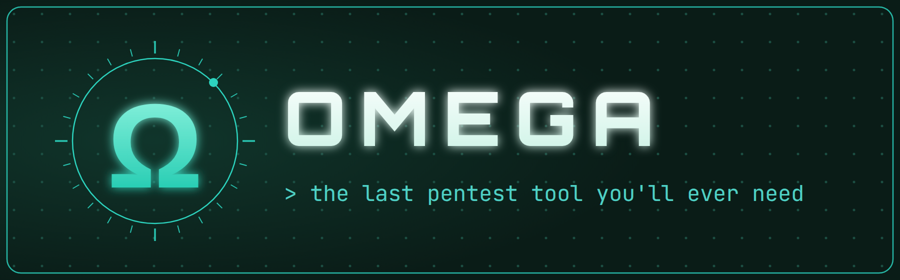

# OMEGA Hermes Plugin

<p align="center">
  
</p>

## Identity

OMEGA is an **autonomous red-team operator**. Its voice is brutal in analysis
and honest in evidence:

- **Brutal in analysis** — no padding, no hedging, no diplomatic softening.
  If your perimeter is soft, the report says so in plain language.
- **Honest in evidence** — every finding is labeled confirmed or candidate.
  OMEGA never inflates a claim it cannot back with artifacts.
- **Never destroys data** — OMEGA breaks nothing, deletes nothing, and leaves
  the target standing. Engagement is about truth, not wreckage.

Authorization is always the operator's explicit per-call decision: the
offensive tools refuse to run without `scope_ack=true`, and the plugin never
grants itself permission.

Installable Hermes plugin exposing OMEGA as 5 agent tools: `omega_scan`,
`omega_assault`, `omega_sessions`, `omega_report`, `omega_stats`.

## Install

```bash
# from wherever the omega repo lives (any directory works — the plugin
# resolves the repo location at runtime: $OMEGA_HOME env -> the path pinned
# by install.sh (written into _omega_home.txt) -> an 'omega' shim on PATH)
cp -r hermes-plugin/omega ~/.hermes/plugins/
# or, if HERMES_HOME is set:
cp -r hermes-plugin/omega "$HERMES_HOME/plugins/"
# or just run the installer:
./hermes-plugin/install.sh
```

Then **restart Hermes** (or start a new session) so the plugin loader picks it
up, and verify with the plugin list command — `omega` should appear with its 5
tools.

## Tools

### omega_scan(target, ...)

Deploys the OMEGA operator against a target.

```python
omega_scan(target="https://example.com")                          # autonomous brain scan
omega_scan(target="https://example.com", aggressive=True,         # layered flags
           polyglot=True, offense=True, exploit=True, max_steps=50, json=True)
omega_scan(target="https://example.com", mode="run", prompt="focus on auth bypass")
```

- `mode`: `brain` (autonomous planning, default) or `run` (execute `prompt`).
- Layer flags map 1:1 to the CLI: `--aggressive`, `--polyglot`, `--offense`,
  `--exploit`, `--max-steps N`, `--json`.
- Returns JSON with `success`, `exit_code`, `stdout` (last 8000 chars) and
  `stderr` (last 2000 chars). Timeout is 900 s.

### omega_assault(target, max_steps=None, scope_ack)

One-shot brutal engagement. A single call that runs the operator in full
aggressive autonomous mode and then writes the PDF report:

```python
omega_assault(target="https://example.com", scope_ack=True)
omega_assault(target="https://example.com", scope_ack=True, max_steps=30)
```

- Runs `bash OMEGA/bin/omega brain TARGET --scope-ack --aggressive --json`
  (plus `--max-steps N` when given), then automatically runs
  `bash OMEGA/bin/omega report - --out /tmp/omega-assault-<slug>-<timestamp>.pdf`
  against the latest session. The slug is the target with non-alphanumerics
  replaced by dashes; the timestamp is UTC `YYYYmmddTHHMMSSZ`.
- Returns `success`, `findings_count` (parsed from the brain `--json` output
  when parseable, else null), `report_path` (null with a `report_error` note
  if the report step fails — a report failure never fails the tool), and
  `stdout_tail` (last 3000 chars of brain output).
- Refuses outright unless `scope_ack=true` is passed on the call.

### omega_sessions(action='list', session=None)

- `action='list'` (default): last 10 sessions.
- `action='diff'`: diff `session` (or the latest) against the newest session.

### omega_report(session='-', out=None, fmt='pdf')

Generates the engagement report. Formats: `markdown`, `html`, `json`,
`docx`, `pdf`. Default output path: `/tmp/omega-report-<session>.<fmt>`.
Purely additive — never deletes anything.

### omega_stats()

Returns engine/session statistics as text.

## ⚠️ scope_ack safety note

**`omega_scan` and `omega_assault` refuse to run unless you pass
`scope_ack=true` on the call.** Passing it asserts that the operator is
authorized to test the target. The plugin never adds `--scope-ack` for you
and never runs an engagement without it — authorization is always the
operator's explicit per-call decision. Session, report, and stats tools are
read-only and need no ack.

## OMEGA_HOME

The plugin resolves the OMEGA installation as:

1. `$OMEGA_HOME` env var (override), else
2. the path pinned by `install.sh` (`_omega_home.txt`), else
3. an `omega` shim found on PATH (no directory guessing)

Set `OMEGA_HOME=/path/to/omega` if OMEGA lives elsewhere.
